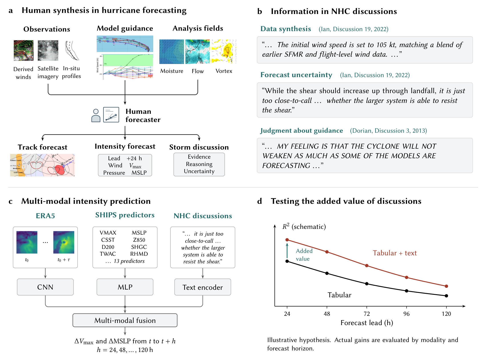

# Quantifying the added value of human forecaster discussions for tropical cyclone intensity prediction

**[Ilia Azizi](https://iliaazizi.com)**1,4 · **[Frederick Iat-Hin Tam](https://scholar.google.fr/citations?user=6XwwNFoAAAAJ&hl=en)**2,3,4 · **[Marc-Olivier Boldi](https://applicationspub.unil.ch/interpub/noauth/php/Un/UnPers.php?PerNum=1073453&LanCode=37)**1,4 · **[Valérie Chavez-Demoulin](https://applicationspub.unil.ch/interpub/noauth/php/Un/UnPers.php?PerNum=1081431&LanCode=37)**1,3,4 · **[Tom Beucler](https://wp.unil.ch/dawn/our-team/)**2,3,4

1 Department of Operations, HEC Lausanne 
2 Faculty of Geosciences and Environment 
3 Expertise Center for Climate Extremes 
4 University of Lausanne, Switzerland

*The curves are schematic and do not show measured results.*

🚧 Code Coming very soon 🚧